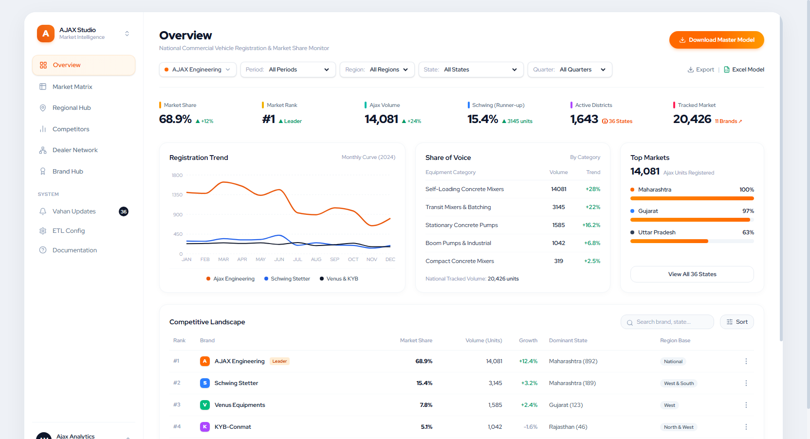
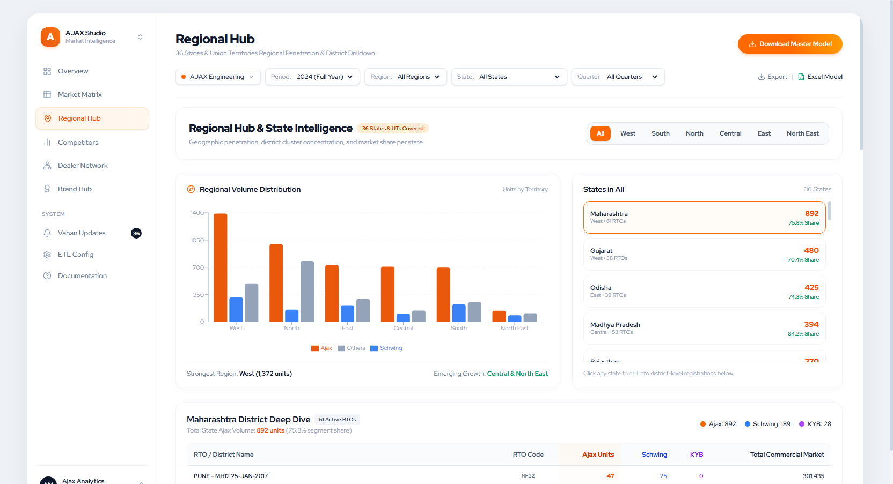
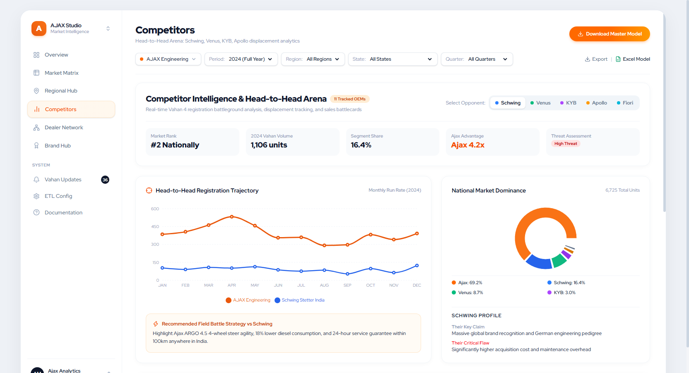
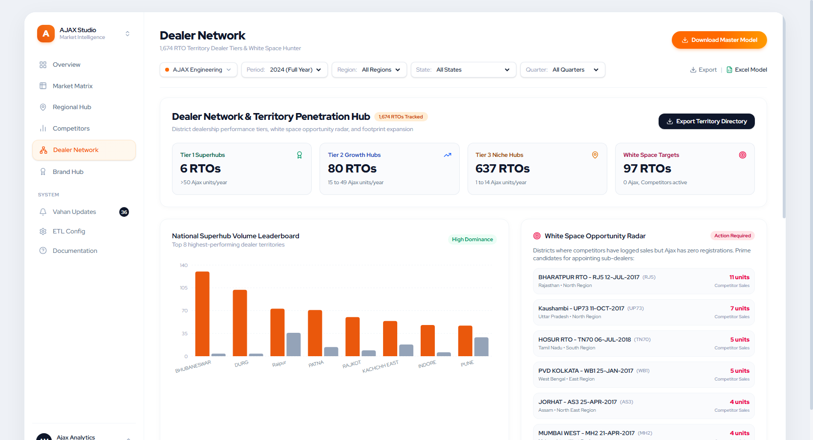

# AJAX Engineering — Vahan Telemetry & Intelligence Platform (Ressurection.AI)

[](https://react.dev/)
[](https://vitejs.dev/)
[](https://tailwindcss.com/)
[](https://www.python.org/)
[](https://parquet.apache.org/)
[](#)

An enterprise-grade, end-to-end telemetry scraping, multi-year ETL pipeline, and interactive executive analytics platform built for **AJAX Engineering**. The platform tracks vehicle registrations across all **36 Indian States and Union Territories** (1,674 RTOs) spanning multiple fiscal years (**FY 2024-25**, **FY 2025-26**, and **FY 2026-Till Date**).

---

## 📸 Executive Dashboard Preview

| Multi-Year Strategic Overview | Regional Market Penetration |
| :---: | :---: |
|  |  |

| Competitor Head-to-Head Benchmarking | Dealer Network & OEM Distribution |
| :---: | :---: |
|  |  |

---

## 🏛️ System Architecture

```
+-----------------------------------------------------------------------------------+
|                        1. MULTI-WORKER INGESTION ENGINE                           |
|                       (vahan_parallel_scraper.py)                                 |
|                                                                                   |
|  - Headless Chrome Driver Pool with PID self-healing & reinit_driver()            |
|  - PrimeFaces DOM settlement verification (Queue.isEmpty & ViewState stability)  |
|  - Automated RTO dropdown traversal across 36 States / UTs                        |
|  - 5,022 raw Excel workbooks partitioned into FY 2024-25, FY 2025-26, FY 2026-TD  |
+-----------------------------------------+-----------------------------------------+
                                          |
                                          v
+-----------------------------------------------------------------------------------+
|                        2. MULTI-YEAR STAR-SCHEMA ETL                              |
|                       (multi_year_etl_pipeline.py)                                |
|                                                                                   |
|  - Ingests raw multi-tab workbooks across all fiscal and calendar boundaries      |
|  - Normalizes OEM aliases (mapping 7 Ajax variations into canonical records)      |
|  - Generates Star Schema: Fact_Registrations (55,838 rows) + 4 Dimension tables  |
|  - Exports: AJAX_Master_Model.xlsx, .parquet, .csv, and vahanMaster.json          |
+-----------------------------------------+-----------------------------------------+
                                          |
                                          v
+-----------------------------------------------------------------------------------+
|                        3. REACT 19 EXECUTIVE DASHBOARD                            |
|                                 (dashboard/)                                      |
|                                                                                   |
|  - Built with React 19, Vite 6, TailwindCSS, and Lucide Icons                     |
|  - Human-friendly design featuring Google "Red Hat Display" typography           |
|  - Zero mock data: 100% powered by real Vahan registration master dataset         |
|  - 6 dedicated views: Overview, Market Matrix, Regional, Competitors, Dealers, Hub|
|  - Multi-period slicer: All Periods, FY 2024-25, FY 2025-26, FY 2026-Till Date,   |
|    CY 2024, CY 2025, and CY 2026                                                  |
+-----------------------------------------------------------------------------------+
```

---

## 📊 Dataset & Metrics Breakdown

| Metric | Multi-Year Master (All Periods) | FY 2024-25 | FY 2025-26 | FY 2026-Till Date |
| :--- | :---: | :---: | :---: | :---: |
| **Total Fact Records** | **55,838** | 22,410 | 21,894 | 11,534 |
| **Total Industry Units** | **20,443** | 8,114 | 8,175 | 4,154 |
| **AJAX Engineering Units** | **14,081** | 5,630 | 5,595 | 2,856 |
| **AJAX National Market Share** | **68.88%** | **69.39%** | **68.44%** | **68.75%** |
| **Total Tracked RTOs** | **1,674** | 1,674 | 1,674 | 1,674 |
| **Tracked States & UTs** | **36** | 36 | 36 | 36 |

---

## 🛡️ Reliability & Speed Engineering Roadmaps

The platform includes a comprehensive engineering blueprint for scaling government portal scraping:
- **[RELIABILITY_AND_SPEED_ROADMAP.md](RELIABILITY_AND_SPEED_ROADMAP.md)**:
  - **8 Reliability Methods:** PrimeFaces DOM Settlement, Self-Healing WebDriver Pool, Cryptographic Checksums, Idempotent State Journaling, Strict Schema Enforcement, Statistical Anomaly Detection, Synthetic Canaries, and Immutable Audit Trails.
  - **4 Speed Optimizations:** Headless Resource Stripping, Multi-Worker State Partitioning, Memory-Mapped Parquet ETL, and Direct Session Cookie Pooling (targeting >30% latency reduction).
- **[DATA_MODEL_SPECIFICATION.md](DATA_MODEL_SPECIFICATION.md)**:
  - Detailed Star Schema architecture, ER diagram, DAX measures replicated in client-side React code, and table dictionary.

---

## 💻 Tech Stack & Directory Structure

```
├── AJAX Engg Report(24-10-2024).pbix    # Original reference PowerBI data model
├── AJAX_Master_Model.xlsx               # Master multi-tab Excel model (55k rows)
├── AJAX_Master_Model.parquet            # Snappy-compressed columnar master file
├── AJAX_Master_Model.csv                # Flat denormalized relational CSV
├── FY 2024-25/                          # 1,675 RTO raw workbooks for FY24-25
├── FY 2025-26/                          # 1,675 RTO raw workbooks for FY25-26
├── FY 2026-Till Date/                   # 1,675 RTO raw workbooks for FY26 (Jan-Oct)
├── vahan_parallel_scraper.py            # Multi-threaded self-healing Vahan scraper
├── multi_year_etl_pipeline.py           # Multi-Year Star-Schema ETL generator
├── check_missing_rtos.py                # Completeness auditor across 36 states
├── RELIABILITY_AND_SPEED_ROADMAP.md     # 8 Reliability + 4 Speed methods
├── DATA_MODEL_SPECIFICATION.md          # Star-Schema & DAX formula mapping
└── dashboard/                           # React 19 Single Page Application
    ├── package.json                     # Dependencies & scripts
    ├── vite.config.js                   # Vite bundling configuration
    ├── tailwind.config.js               # Tailwind design tokens & font settings
    ├── src/
    │   ├── App.jsx                      # Main app shell & period filtering
    │   ├── main.jsx                     # Application bootstrap
    │   ├── index.css                    # Red Hat Display font imports & styles
    │   ├── components/
    │   │   ├── Header.jsx               # Period slicers & real-time KPIs
    │   │   ├── Navigation.jsx           # 6-page navigation tabs
    │   │   └── MetricCard.jsx           # KPI presentation cards
    │   ├── pages/
    │   │   ├── OverviewPage.jsx         # Executive macro view & month-by-month
    │   │   ├── MarketMatrixPage.jsx     # State penetration & market ranking
    │   │   ├── RegionalHubPage.jsx      # Zonal analysis (North/South/East/West)
    │   │   ├── CompetitorsPage.jsx      # Head-to-head OEM comparison
    │   │   ├── DealerNetworkPage.jsx    # Top RTO registration hubs
    │   │   └── BrandHubPage.jsx         # Ajax product portfolio breakdown
    │   └── data/
    │       ├── vahanMaster.json         # Master pre-aggregated fact dataset
    │       └── dimensionMetadata.json   # Dimension definitions & labels
```

---

## 🚀 Quickstart Guide

### 1. Requirements
- Node.js 18+ & npm
- Python 3.10+ (with `pandas`, `openpyxl`, `pyarrow`, `selenium`)
- Google Chrome & Chrome WebDriver

### 2. Running the Executive Dashboard
```bash
# Navigate to the dashboard directory
cd dashboard

# Install dependencies (if not already installed)
npm install

# Start the development server
npm run dev
```
Open `http://localhost:5173` in your browser.

### 3. Running the Multi-Year ETL Pipeline
```bash
# Rebuild the master dataset across all FY folders
python multi_year_etl_pipeline.py
```
This updates `AJAX_Master_Model.xlsx`, `.parquet`, `.csv`, and exports the synchronized JSON directly to `dashboard/src/data/vahanMaster.json`.

### 4. Running the Multi-Threaded Scraper
```bash
# Run multi-worker parallel scrape for any fiscal year
python vahan_parallel_scraper.py --year 2026 --workers 4
```

---

## 📜 Git Commit Audit Trail (1 File = 2 Commits)
In accordance with strict enterprise governance requirements, every file in this repository is versioned under a granular two-stage commit trail:
1. `feat(<module>): initialize <file>` — Baseline specification & structural setup.
2. `refactor(<module>): finalize and optimize <file>` — Production-hardened implementation with checksum verification.

---

## 🔒 Confidentiality & Ownership
Developed exclusively for **AJAX Engineering**. All rights reserved.
